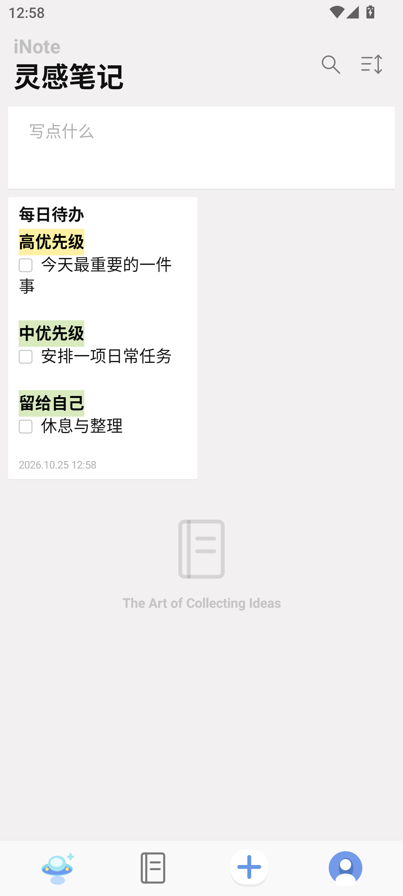
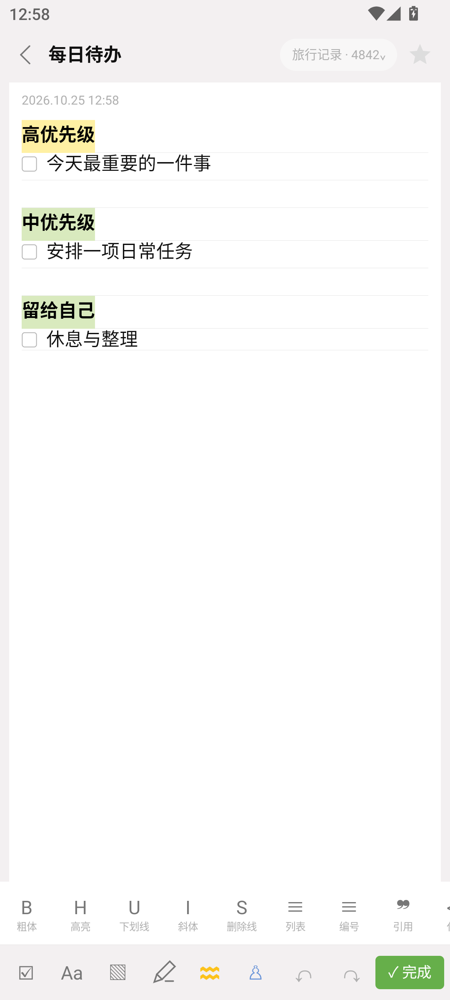
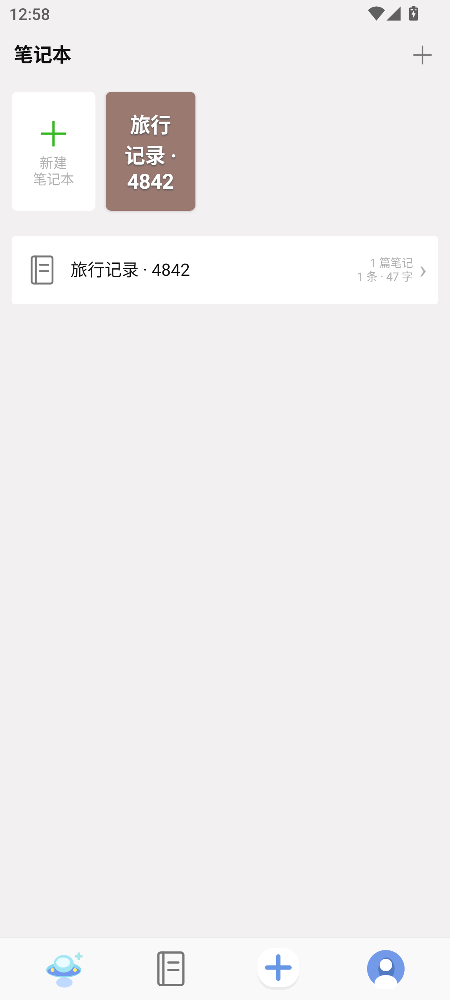
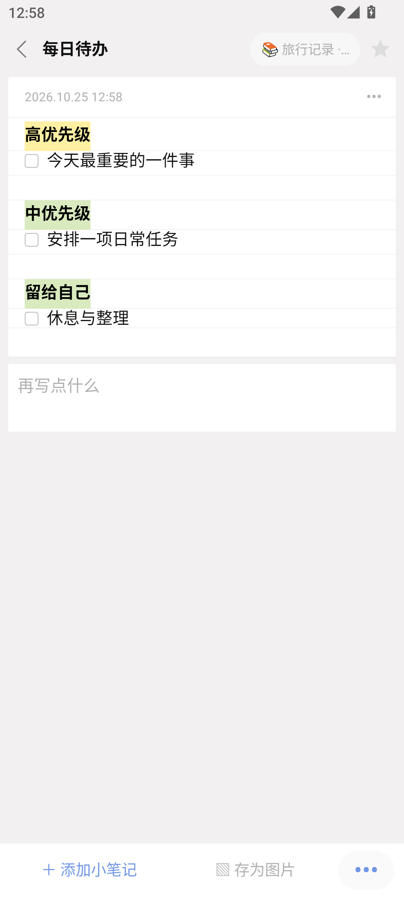
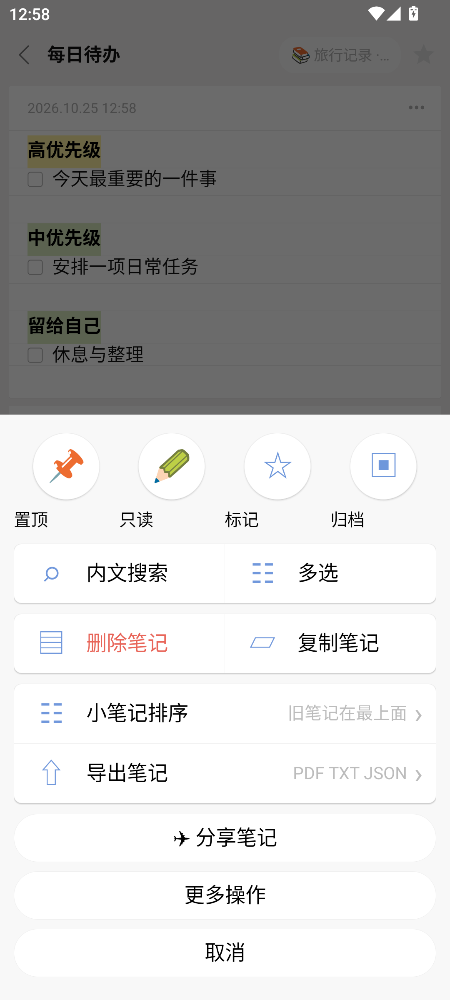
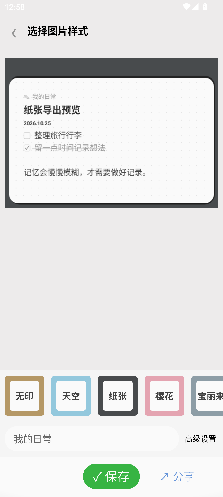

  <h1>灵感笔记 · iNote Android</h1>
  
<strong>一款偏爱纸张质感的离线笔记应用。</strong>

  
用多条小笔记串起一个主题，收纳文字、清单与图片，按自己的节奏整理与回顾。

  

    <a href="https://github.com/oldjie/inote-android/releases/latest">下载安装</a> ·
    <a href="#界面预览">界面预览</a> ·
    <a href="#功能特性">功能特性</a> ·
    <a href="#快速开始">使用说明</a> ·
    <a href="PRIVACY.md">隐私说明</a>
  

  

    
    
    
  

## 关于灵感笔记

使用 Java 与 Android 原生界面实现，支持 Android 8.0 及以上。笔记、图片与草稿均保存在本机，无需账号或云同步。

> 这是受 iOS iNote 使用方式启发的独立 Android 实现，与 iNote 原开发者无隶属、合作或授权关系，也不是其官方移植。公开版不包含原版 IPA、提取图标、封面、字体或模板；使用独立绘制的图标、封面与自编模板。

## 下载安装

前往 [GitHub Releases](https://github.com/oldjie/inote-android/releases/latest) 下载 `inote-community-v0.3.1.apk`，安装前可对照同页 SHA-256 文件。此为公开社区版，与自用版包名不同。

## 界面预览

  
  
  
  
笔记首页 · 富文本编辑 · 笔记本书架

  
  
  
  
笔记详情 · 操作面板 · 图片导出

### 桌面小组件

  
  
  
笔记便签 · 快捷记录

  
以上为公开版模拟器截图，使用自编示例内容。

## 功能特性

| 功能 | 说明 |
| --- | --- |
| 多段笔记 | 一篇笔记容纳多条记录，逐条编辑、折叠和整理 |
| 富文本 | 粗体、斜体、下划线、删除线、高亮、等宽字、列表与引用 |
| 图片与待办 | 添加本地图片，使用清单记录和勾选任务 |
| 手写 | 黑、蓝、红画笔，撤销与清空，保存为笔记图片 |
| 笔记本 | 笔记可归入多个笔记本，支持封面和图标选择 |
| 查找整理 | 搜索、置顶、星标、颜色、归档与回收站 |
| 阅读外观 | 纸张横线、卡片列表、浅色与深色主题 |
| 模板 | 54 份自编简体模板，繁体及英文各 1 份；可将文字笔记保存为个人模板 |
| 万能戳 | 插入日期、时间、数学符号和分割线 |
| 桌面小组件 | 2×2 快捷记录、可调整大小的笔记便签，纸张／木纹／天空外观和大字标语 |
| 记忆卡片 | 将记录组成问答卡片，按本项目的复习间隔回顾 |
| 本地备份 | 导出 JSON，导入时合并笔记、图片和关联信息 |
| 分享输出 | PNG 五种图片主题、署名／日期／字号预览；PDF、TXT、复制文本与单篇 JSON |

不包含云同步、账号系统、密码锁、广告或统计 SDK。

## 快速开始

首次打开后，点底部新建按钮创建空白笔记或选择模板。在笔记中追加小笔记；在「笔记本」中按主题归类；在「我的」中切换主题、备份数据或进入记忆卡片。

**卸载前请导出备份。** 应用数据保存在本机私有目录，卸载会删除。备份导入采用合并方式，重复导入可能产生重复内容；导入前建议先备份现有数据。

仓库提供源代码，公开体验 APK 可从 Releases 下载。自行构建的 Debug APK 仅用于开发与个人测试。

### 鸿蒙 4.2 桌面小组件

安装并打开应用后，在桌面双指捏合，进入「服务卡片」，滑到底部选择「窗口小工具」，找到灵感笔记。选择快捷记录，或添加笔记便签后指定内容和外观。长按小组件可在桌面支持时调整大小。

不同桌面版本入口可能不同，详见[小组件使用与验证说明](docs/WIDGETS.md)。

## 数据与隐私

- 应用不声明 `INTERNET` 权限，无远程服务、遥测、广告与登录。
- 笔记、草稿和图片保存在应用私有目录；系统备份及设备迁移备份已禁用。
- 本地数据库和导出的 JSON **没有应用层加密**。导出文件由你选择保存位置，请自行保管。
- 点击笔记中的网页或邮件链接可能打开外部应用；后续网络行为由该应用负责。导入富文本只保留 `http`、`https` 和 `mailto` 链接。
- PNG / PDF 会包含选定笔记的可见内容；分享前请检查隐私信息。
- 小组件将所选笔记摘要交给桌面程序显示；归档或移入回收站后会隐藏正文。
- 自定义模板只保存文字与格式，目前不包含在笔记 JSON 备份中；有重要模板时请同时保留对应笔记。

详见 [隐私说明](PRIVACY.md) 和 [安全说明](SECURITY.md)。

## 与 iOS 原版文件的关系

本应用 JSON 备份是独立格式，不能直接导回 iOS iNote。源码保留了有限的 `.inote` v1 文字格式适配器，但**公开构建默认未配置解码参数**，不承诺能导入原版文件；包含附件或未知结构的文件会被拒绝。

解码参数、原版文件和分析材料均不在仓库中。开发者如有自行取得的兼容参数，可在自己的 Gradle 用户配置中设置 `inoteImportKey`；参数会编译进入 APK，不能视为安全秘密，也不要提交或公开带参数的构建。日常迁移推荐使用本应用 JSON 备份。

## 源码导航

查看主要源码模块

- `MainActivity.java`：主界面、编辑、笔记本与导入导出入口。
- `NoteStore.java`：SQLite 数据模型、备份和图片生命周期。
- `RichText.java` / `PaperChecks.java`：文本样式序列化与清单显示。
- `TemplateLibrary.java` / `TemplatePicker.java`：模板渲染与选择。
- `NoteExporter.java`：图片与 PDF 输出。
- `CommunityIcon.java`：公开版独立绘制的图标与封面。
- `PaperSheet.java` / `ExportStyleActivity.java`：底部操作面板与图片导出预览。
- `WidgetSupport.java` / `NoteWidgetConfigActivity.java`：桌面小组件更新与配置。
- `CustomTemplateStore.java`：应用私有目录中的自定义模板。
- `app/src/androidTest`：设备端回归测试，使用生成数据，不含原版安装包样本。

代码位于 `app/src/main/java/com/personal/inote`。欢迎提交问题与改进；问题报告请描述设备版本、复现步骤和期望行为，勿附真实笔记、密钥或未经脱敏的备份。

## 许可与声明

本仓库的独立实现代码及自编示例素材采用 [MIT License](LICENSE)。该许可不授予任何第三方商标、原版应用或其素材的权利。iNote 名称仅用于说明项目来源与兼容目标。详见 [NOTICE](NOTICE.md)。

---

  灵感笔记 · 按自己的节奏记录与回顾。

