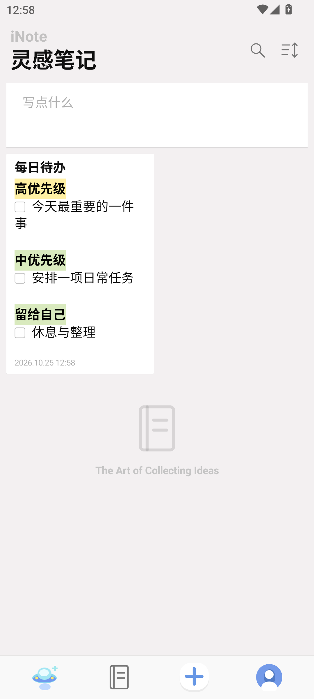
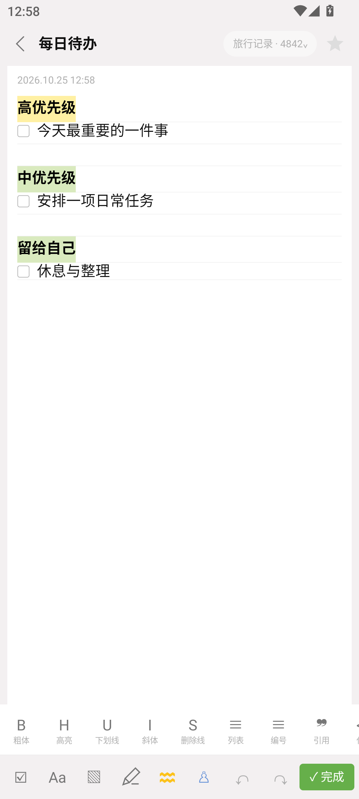
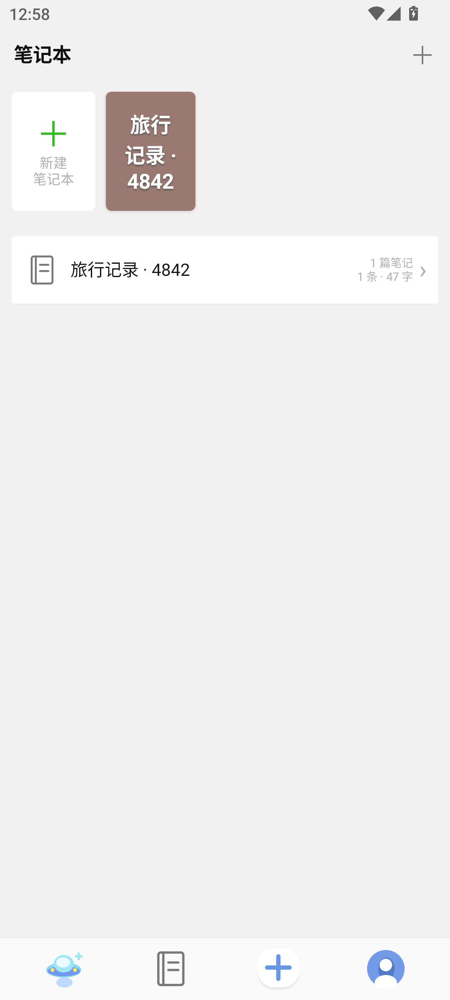
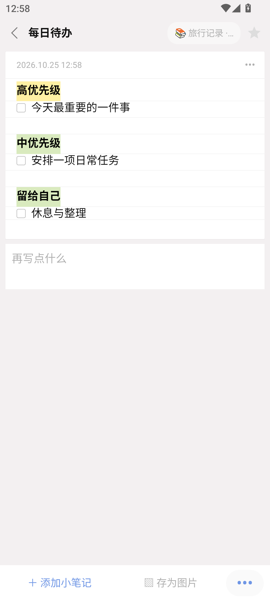
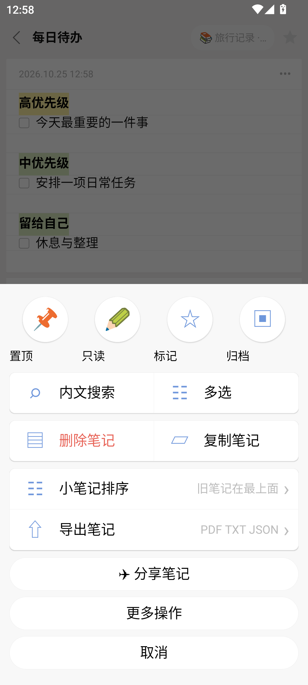
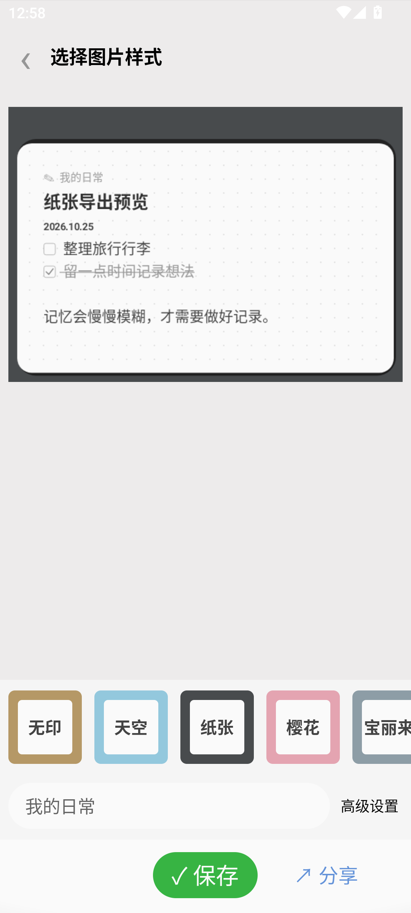

# 灵感笔记 · Android

**一款偏爱纸张质感的离线笔记应用（inote android 版非官方）。**

用多条小笔记串起一个主题，把文字、清单和图片收进笔记本，再按自己的节奏整理与回顾。支持 Android 8.0 及以上，使用 Java 和 Android 原生界面实现。

> 这是受 iOS iNote 使用方式启发的独立 Android 实现，与 iNote 原开发者无隶属、合作或授权关系，也不是其官方移植。公开版不包含原版 IPA、提取图标、封面、字体或模板；使用独立绘制的图标、封面与自编模板。0.3 版本依据实际界面截图进一步对齐布局，但不宣称逐像素相同。

## 下载安装

前往 [GitHub Releases](https://github.com/oldjie/inote-android/releases/latest) 下载 `inote-community-v0.3.1.apk`，安装前可对照同页 SHA-256 文件。此为公开社区版，与自用版包名不同。当前使用开发签名供体验，正式分发签名尚未建立。

## 界面预览

以下为公开版模拟器截图，仅使用自编示例内容。

<p>
  
  
  
</p>

<p>
  
  
  
</p>

<p>
  
  
</p>

## 可以做什么

| 功能 | 说明 |
| --- | --- |
| 多段笔记 | 一篇笔记容纳多条记录，逐条编辑、折叠和整理 |
| 富文本 | 粗体、斜体、下划线、删除线、高亮、等宽字、列表与引用 |
| 图片与待办 | 添加本地图片，使用清单记录和勾选任务 |
| 手写 | 黑、蓝、红画笔，撤销与清空，保存为笔记图片 |
| 笔记本 | 笔记可归入多个笔记本，支持封面和图标选择 |
| 查找整理 | 搜索、置顶、星标、颜色、归档与回收站 |
| 阅读外观 | 纸张横线、卡片列表、浅色与深色主题 |
| 模板 | 54 份自编简体模板，繁体及英文各 1 份；可将文字笔记保存为个人模板 |
| 万能戳 | 插入日期、时间、数学符号和分割线 |
| 桌面小组件 | 2×2 快捷记录、可调整大小的笔记便签，纸张／木纹／天空外观和大字标语 |
| 记忆卡片 | 将记录组成问答卡片，按本项目的复习间隔回顾 |
| 本地备份 | 导出 JSON，导入时合并笔记、图片和关联信息 |
| 分享输出 | PNG 五种图片主题、署名／日期／字号预览；PDF、TXT、复制文本与单篇 JSON |

不包含云同步、账号系统、密码锁、广告或统计 SDK。记忆复习规则为本项目实现，不宣称与 iOS 原版算法一致。

## 快速开始

首次打开后，点底部新建按钮创建空白笔记或选择模板。在笔记中追加小笔记；在「笔记本」中按主题归类；在「我的」中切换主题、备份数据或进入记忆卡片。

**卸载前请导出备份。** 应用数据保存在本机私有目录，卸载会删除。备份导入采用合并方式，重复导入可能产生重复内容；导入前建议先备份现有数据。

当前仓库提供源代码，不附带签名发布包。自行构建的 Debug APK 仅用于开发与个人测试。

### 鸿蒙 4.2 桌面小组件

安装并打开应用后，在桌面双指捏合，进入「服务卡片」，滑到底部选择「窗口小工具」，找到灵感笔记。选择快捷记录，或添加笔记便签后指定内容和外观。长按小组件可在桌面支持时调整大小。

这是兼容 APK 系统的 **Android 窗口小工具**。已在 Android 模拟器验证实际绑定、配置、刷新及尺寸调整，**尚未在鸿蒙 4.2 真机验证**，不宣称支持 HarmonyOS NEXT。不同桌面版本入口可能不同，详见[小组件使用与验证说明](docs/WIDGETS.md)。

## 构建

需要 JDK 17、Android SDK Platform 35、Build Tools 35.0.0。Gradle Wrapper 使用 8.9，Android Gradle Plugin 使用 8.7.3。

1. 克隆仓库并用 Android Studio 打开根目录。
2. 配置 JDK 17 与 Android SDK。命令行用户可设置 `ANDROID_HOME`，或在未跟踪的 `local.properties` 中填写 `sdk.dir`。
3. 构建和静态检查：

```sh
# macOS / Linux
./gradlew assembleDebug lintDebug assembleDebugAndroidTest
```

```powershell
# Windows PowerShell
.\gradlew.bat assembleDebug lintDebug assembleDebugAndroidTest
```

首次构建会下载构建工具与依赖。若确有需要，可设置 `INOTE_MAVEN_MIRROR=1` 使用构建配置中的阿里云 Maven 镜像；默认使用 Google 和 Maven Central。

输出 APK：`app/build/outputs/apk/debug/app-debug.apk`。公开版应用 ID 是 `com.oldjie.inote.community`，与自用实验版分开安装，不会直接读取其私有数据库。迁移请使用 JSON 备份。

### 设备测试

连接 Android 设备或模拟器后运行（多设备时在 `adb` 后加 `-s <序列号>`）：

```sh
adb install -r app/build/outputs/apk/debug/app-debug.apk
adb install -r app/build/outputs/apk/androidTest/debug/app-debug-androidTest.apk
adb shell am instrument -w com.oldjie.inote.community.test/com.personal.inote.PersonalTestRunner
```

测试覆盖本地存储、富文本、备份合并与拒绝无效数据、图片生命周期、记忆卡片、导出以及界面基本操作。界面测试使用 Android 10+ 的窗口检查接口，请在 Android 10 或更新版本执行完整测试。测试数据会清理，但仍建议使用测试设备。

验证范围包含本地数据、导出隐私边界、模板、富文本危险协议、实际小组件绑定、配置、调整大小与更新。每个版本的检查结果和已知差异见[更新记录](CHANGELOG.md)，不代表覆盖全部 Android 设备。

0.3.0 验证记录：构建及 Android Lint 通过；Android 12 模拟器 **42 项设备测试全部通过**。小组件测试包含实际点击打开指定笔记、快捷记录输入保存，以及拒绝伪造入口。

## 数据与隐私

- 应用不声明 `INTERNET` 权限，无远程服务、遥测、广告与登录。
- 笔记、草稿和图片保存在应用私有目录；系统备份及设备迁移备份已禁用。
- 本地数据库和导出的 JSON **没有应用层加密**。导出文件由你选择保存位置，请自行保管。
- 点击笔记中的网页或邮件链接可能打开外部应用；后续网络行为由该应用负责。导入富文本只保留 `http`、`https` 和 `mailto` 链接。
- PNG / PDF 会包含选定笔记的可见内容；分享前请检查隐私信息。
- 小组件将所选笔记摘要交给桌面程序显示；归档或移入回收站后会隐藏正文。
- 自定义模板只保存文字与格式，目前不包含在笔记 JSON 备份中；有重要模板时请同时保留对应笔记。

详见 [隐私说明](PRIVACY.md) 和 [安全说明](SECURITY.md)。这里的检查是源码审查与回归验证，不是独立第三方安全认证。

## 与 iOS 原版文件的关系

本应用 JSON 备份是独立格式，不能直接导回 iOS iNote。源码保留了有限的 `.inote` v1 文字格式适配器，但**公开构建默认未配置解码参数**，不承诺能导入原版文件；包含附件或未知结构的文件会被拒绝。

解码参数、原版文件和分析材料均不在仓库中。开发者如有自行取得的兼容参数，可在自己的 Gradle 用户配置中设置 `inoteImportKey`；参数会编译进入 APK，不能视为安全秘密，也不要提交或公开带参数的构建。日常迁移推荐使用本应用 JSON 备份。

## 源码导航

- `MainActivity.java`：主界面、编辑、笔记本与导入导出入口。
- `NoteStore.java`：SQLite 数据模型、备份和图片生命周期。
- `RichText.java` / `PaperChecks.java`：文本样式序列化与清单显示。
- `TemplateLibrary.java` / `TemplatePicker.java`：模板渲染与选择。
- `NoteExporter.java`：图片与 PDF 输出。
- `CommunityIcon.java`：公开版独立绘制的图标与封面。
- `PaperSheet.java` / `ExportStyleActivity.java`：底部操作面板与图片导出预览。
- `WidgetSupport.java` / `NoteWidgetConfigActivity.java`：桌面小组件更新与配置。
- `CustomTemplateStore.java`：应用私有目录中的自定义模板。
- `app/src/androidTest`：设备端回归测试，使用生成数据，不含原版安装包样本。

代码位于 `app/src/main/java/com/personal/inote`。欢迎提交问题与改进；问题报告请描述设备版本、复现步骤和期望行为，勿附真实笔记、密钥或未经脱敏的备份。

## 许可与声明

本仓库的独立实现代码及自编示例素材采用 [MIT License](LICENSE)。该许可不授予任何第三方商标、原版应用或其素材的权利。iNote 名称仅用于说明项目来源与兼容目标。详见 [NOTICE](NOTICE.md)。
